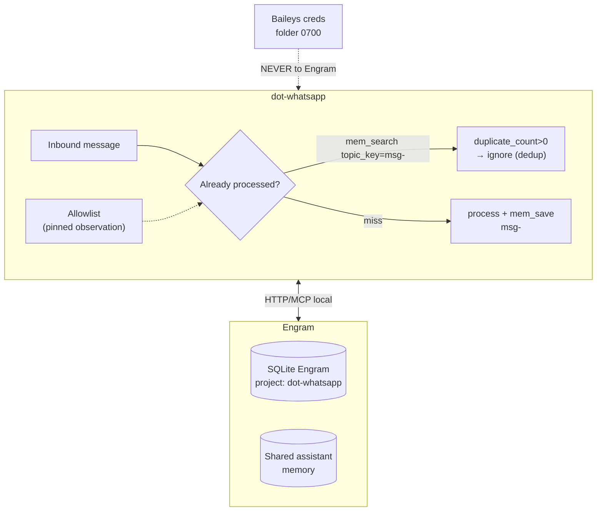
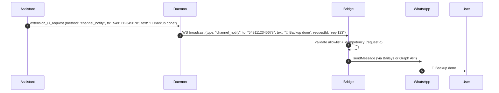

<!-- markdownlint-disable-next-line MD041 -->
<a id="top"></a>

<div align="center">

[](https://github.com/Gentleman-Programming/gentle-ai)


<h1>dot-whatsapp</h1>

<p><strong>Your Gentle Dot assistant, one WhatsApp message away.</strong></p>

<p>


<a href="LICENSE"></a>
</p>

<p>
<a href="https://gentlemanprogramming.com/"><strong>Website</strong></a> &bull;
<a href="docs/RUNBOOK.md"><strong>Runbook</strong></a> &bull;
<a href="Propuesta — dot-whatsapp (WhatsApp para Gentle Dot).md"><strong>Study</strong></a> &bull;
<a href="https://github.com/Gentleman-Programming/gentle-dot"><strong>Gentle Dot</strong></a>
</p>

<br/>

<p>
Assistants live in a browser tab you have to go find, forget you between chats, and stop at the edge of the page.
<strong>dot-whatsapp brings Gentle Dot to WhatsApp: one continuous conversation with real memory, relayed through an opt-in, separate bridge process that never changes Gentle Dot itself.</strong>
</p>

</div>

<br/>

> [!WARNING]
> **Prototype.** This bridge talks to Gentle Dot's client protocol v1, which is not a published API and may change. It relays an assistant that can act on your behalf: read Security below before running it. Uses Baileys (unofficial WhatsApp Web client): use a **dedicated number**, human volume; see the study for the ban risk and the planned official Meta Cloud API provider.

<br/>

<div align="center"></div>

## Features

---

### One conversation, everywhere

Your Gentle Dot chat is continuous — desktop, web, and now WhatsApp share the same memory (Engram) and history. A question on WhatsApp picks up where you left off on your Mac. No threads to manage, no context to re-explain.

---

### Opt-in, separate process

dot-whatsapp runs as its own systemd `--user` service. It connects to the Gentle Dot daemon as one more WebSocket client (`protocol v1`, access key from `~/.gentle-dot/token`). **Gentle Dot itself never changes.** If you don't run it, it doesn't exist.

```mermaid
flowchart LR
    subgraph phone["📱 Your Phone"]
        WA["WhatsApp"]
    end

    subgraph host["🖥️ Your Machine / Server"]
        subgraph bridge["dot-whatsapp (opt-in process)"]
            BB["@whiskeysockets/baileys<br/>(multi-device socket,<br/>QR pairing once)"]
            ROUTER["Bridge Router<br/>· E.164 allowlist<br/>· anti-loop / rate limit<br/>· message splitting<br/>· idempotency via Engram"]
            DC["daemon-client.ts<br/>(reconnect 1s→30s)<br/>≈ identical to dot-telegram"]
        end

        subgraph state["State (all in Engram)"]
            ENG[("Engram<br/>· assistant memory (shared)<br/>· bridge DB: idempotency,<br/>  allowlist, session state")]
        end
        subgraph dot["Gentle Dot (unchanged)"]
            D["Daemon<br/>ws://127.0.0.1:4317/ws<br/>protocol v1 + access key"]
            ASST["Assistant + memory<br/>(same conversation<br/>as desktop & web)"]
            D --- ASST
        end
    end

    WA <--> WAW
    WAW <-->|"message events"| BB
    BB --> ROUTER --> DC
    DC <-->|"WebSocket + token"| D
    ROUTER <-->|"mem_save / mem_search<br/>(project: dot-whatsapp)"| ENG
    ASST <-->|memory| ENG
    ASST -->|reply| D --> DC --> ROUTER --> BB -->|sendMessage| WAW --> WA

    style bridge fill:#2a1024,stroke:#F095C8
    style dot fill:#121a24,stroke:#7aa2f7
```



---

### Dual provider: choose your trade-off

| Provider | Type | Pros | Cons | Best for |
|---|---|---|---|---|
| **Baileys** (`DOT_WHATSAPP_PROVIDER=baileys`) | Unofficial WhatsApp Web multi-device | Free, no Meta account, full control, QR pairing | Ban risk if abused, dedicated number recommended | Personal use, prototyping |
| **Meta Cloud API** (`DOT_WHATSAPP_PROVIDER=meta-cloud`) | Official WhatsApp Business API | Zero ban risk, templates, SLA, media/buttons native | Meta Business verified, public webhook URL, per-conversation cost, template approval | Production, business use |

Both implement the same internal `ChannelTransport` interface (`start / onMessage / sendText / stop`). Switching providers changes nothing else in the bridge.

---

### Engram: memory **and** bridge DB

Engram serves two roles:

1. **Assistant memory (shared):** The same Engram that desktop, web, and Telegram use — WhatsApp conversations share memory with everything else.
2. **Bridge operational DB (project `dot-whatsapp`):** Idempotency (`topic_key=msg-<wa-id>`), allowlist override (pinned observation), liveness notes. Baileys crypto creds stay in `0700` files, **never in Engram**.



---

### Security (phase 1, non-negotiable)

- **Strict E.164 allowlist:** Only listed numbers can talk to the assistant; everything else is ignored and logged.
- **Anti-loop:** Own messages (fromMe), broadcasts, statuses, and non-text are never relayed.
- **Baileys credentials** on disk with mode `0700`; daemon access key re-read from file before every connection.
- **Idempotency** via Engram (`topic_key=msg-<wa-id>`) so a restart never double-sends.
- **Rate limiting** (P1-1): token bucket per number (1000 msg/day base), exponential backoff retry queue, metrics.
- **Webhook HMAC** (P1-2): `X-Hub-Signature-256` timing-safe validation, 401 on missing/invalid signature, processes payload only after validation.

---

### Admin API (for Gentle Dot Channels panel)

Token-authed HTTP JSON on `127.0.0.1:4407` (Bearer token in `~/.dot-whatsapp/admin-token`, `0600`, re-read per request).

| Endpoint | Description |
|---|---|
| `GET /status` | `{state: off|pairing|connected|error, provider, maskedNumber, lastActivityAt}` |
| `GET /allowlist` | Masked entries only |
| `POST /allowlist` | `{action: add|remove, number: <E.164>}` — hot apply via Engram pinned obs |
| `POST /pair/start` | Start QR pairing |
| `GET /pair/status` | `{qr|null, expiresInSec, attempts}` |
| `POST /pair/regenerate` | New QR |
| `POST /pair/cancel` | Cancel pairing |
| `POST /verify` | Sends "👋 dot-whatsapp vinculado" to allowlist, returns masked results |
| `POST /unpair` | Baileys logout + clear `~/.dot-whatsapp/auth` + state off |

Numbers masked server-side (last 4 digits). Errors: `401/404/409/500` JSON.

---

### Proactive outreach (T11, S9)

The daemon can send `channel_notify` messages to the bridge, which delivers them to allowlisted numbers without a user prompt (reminders, alerts, daily summaries). The daemon validates the number against the bridge's allowlist; the bridge validates again and deduplicates via optional `requestId`.



---

<div align="right"><a href="#top">Back to top</a></div>

<div align="center"></div>

## Get started

### Prerequisites

- Node.js ≥ 22.18 (pinned via corepack pnpm 11.5.0)
- Gentle Dot daemon running (`ws://127.0.0.1:4317/ws`)
- Engram server (`http://127.0.0.1:47821`, project `dot-whatsapp`)
- **For Baileys:** A dedicated phone number, WhatsApp installed
- **For Meta Cloud:** Meta Business account, public webhook URL (HTTPS), Meta App credentials

### Quick install

```bash
# Clone and install
git clone https://github.com/Gentleman-Programming/dot-whatsapp.git
cd dot-whatsapp
pnpm install --frozen-lockfile

# Configure
cp .env.example .env
# Edit .env with your values (see below)

# Test run (QR pairing for Baileys)
pnpm start:env

# Install systemd service
systemctl --user enable --now dot-whatsapp.service
```

### Environment variables (`.env`)

| Variable | Required | Default | Description |
|---|---|---|---|
| `DOT_WHATSAPP_ALLOWED_NUMBERS` | ✅ | — | Comma-separated E.164 numbers (digits only, no `+`) |
| `DOT_WHATSAPP_PROVIDER` | — | `baileys` | `baileys` or `meta-cloud` |
| `GENTLE_DOT_URL` | — | `ws://127.0.0.1:4317/ws` | Daemon WebSocket URL |
| `GENTLE_DOT_TOKEN_FILE` | — | `~/.gentle-dot/token` | Daemon access key file |
| `ENGRAM_URL` | — | `http://127.0.0.1:47821` | Engram server URL |
| `DOT_WHATSAPP_ENGRAM_PROJECT` | — | `dot-whatsapp` | Engram project name |
| `DOT_WHATSAPP_AUTH_DIR` | — | `~/.dot-whatsapp/auth` | Baileys credentials (mode 0700) |
| `DOT_WHATSAPP_ADMIN_PORT` | — | `4407` | Admin API port (127.0.0.1) |
| `DOT_WHATSAPP_ADMIN_TOKEN_FILE` | — | `~/.dot-whatsapp/admin-token` | Admin API bearer token (0600) |
| `DOT_WHATSAPP_ALLOWLIST_FILE` | — | `~/.dot-whatsapp/allowlist.json` | Allowlist persistence (0600) |

#### Meta Cloud API (when `DOT_WHATSAPP_PROVIDER=meta-cloud`)

| Variable | Required | Default |
|---|---|---|
| `DOT_WHATSAPP_META_PHONE_NUMBER_ID` | ✅ | — |
| `DOT_WHATSAPP_META_TOKEN` | ✅ | — |
| `DOT_WHATSAPP_META_VERIFY_TOKEN` | ✅ | — |
| `DOT_WHATSAPP_META_APP_SECRET` | ✅ | — |
| `DOT_WHATSAPP_META_WEBHOOK_PORT` | — | `4408` |
| `DOT_WHATSAPP_META_WEBHOOK_HOST` | — | `0.0.0.0` |
| `DOT_WHATSAPP_META_GRAPH_URL` | — | `https://graph.facebook.com` |
| `DOT_WHATSAPP_META_GRAPH_VERSION` | — | `v21.0` |

> **Webhook must be public HTTPS** (Cloudflare Tunnel, ngrok, or VPS with reverse proxy). Meta requires valid TLS cert.

---

### Pairing (Baileys)

```bash
# 1. Start pairing
curl -X POST -H "Authorization: Bearer $(cat ~/.dot-whatsapp/admin-token)" \
  http://127.0.0.1:4407/pair/start

# 2. Get QR (poll until not null)
curl -H "Authorization: Bearer $(cat ~/.dot-whatsapp/admin-token)" \
  http://127.0.0.1:4407/pair/status

# 3. Scan QR with WhatsApp on phone

# 4. Verify connection
curl -X POST -H "Authorization: Bearer $(cat ~/.dot-whatsapp/admin-token)" \
  http://127.0.0.1:4407/verify
```

### Allowlist management

```bash
# List (masked)
curl -H "Authorization: Bearer $(cat ~/.dot-whatsapp/admin-token)" \
  http://127.0.0.1:4407/allowlist

# Add
curl -X POST -H "Authorization: Bearer $(cat ~/.dot-whatsapp/admin-token)" \
  -H "Content-Type: application/json" \
  -d '{"action":"add","number":"5491123456789"}' \
  http://127.0.0.1:4407/allowlist

# Remove
curl -X POST -H "Authorization: Bearer $(cat ~/.dot-whatsapp/admin-token)" \
  -H "Content-Type: application/json" \
  -d '{"action":"remove","number":"5491123456789"}' \
  http://127.0.0.1:4407/allowlist
```

### Unpair

```bash
curl -X POST -H "Authorization: Bearer $(cat ~/.dot-whatsapp/admin-token)" \
  http://127.0.0.1:4407/unpair
```

---

### Systemd service

```bash
# Install
mkdir -p ~/.config/systemd/user
cp docs/dot-whatsapp.service ~/.config/systemd/user/
mkdir -p ~/.config/dot-whatsapp
# Create ~/.config/dot-whatsapp/env with your env vars (see docs/RUNBOOK.md)
systemctl --user daemon-reload
systemctl --user enable --now dot-whatsapp

# Status & logs
systemctl --user status dot-whatsapp
journalctl --user -u dot-whatsapp -f
```

---

### File locations

| Path | Purpose | Permissions |
|---|---|---|
| `~/.dot-whatsapp/auth/` | Baileys credentials | 0700 |
| `~/.dot-whatsapp/admin-token` | Admin API bearer token | 0600 |
| `~/.dot-whatsapp/allowlist.json` | Allowlist persistence | 0600 |
| `~/.gentle-dot/token` | Daemon access key | 0600 |
| `~/.config/dot-whatsapp/env` | systemd EnvironmentFile | 0600 |

---

<div align="right"><a href="#top">Back to top</a></div>

<div align="center"></div>

## Development

```bash
# Tests
pnpm test              # 88/88 passing (excludes E2E + rate-limit WIP)
pnpm test:e2e          # E2E tests (requires docker-compose)
pnpm typecheck         # tsc --noEmit (src only)

# Typecheck
pnpm typecheck

# Build (no build step needed, runs via tsx)
pnpm start:env         # runs with --env-file=.env
```

### Checks

```bash
pnpm typecheck && pnpm test   # unit tests + typecheck
# pnpm e2e                     # E2E with docker-compose (requires daemon + bridge)
```

---

<div align="right"><a href="#top">Back to top</a></div>

<div align="center"></div>

## Project structure

```
dot-whatsapp/
├── src/
│   ├── main.ts                 # Entry point: config → transport → bridge → admin API
│   ├── config.ts               # E.164 validation, provider config, fail-closed Meta Cloud
│   ├── bridge.ts               # Relay daemon↔WhatsApp, allowlist, idempotency, rate limit
│   ├── rate-limit.ts           # Token bucket + exponential backoff (P1-1)
│   ├── protocol.ts             # Protocol v1 types (copied from gentle-dot)
│   ├── daemon-client.ts        # WS client with reconnect 1s→30s
│   ├── transport-factory.ts    # Provider selection (baileys | meta-cloud)
│   ├── whatsapp.ts             # Baileys transport (ChannelTransport impl)
│   ├── meta-cloud-transport.ts # Meta Cloud: webhook HMAC + Graph API (P1-2)
│   ├── admin-api.ts            # Admin API (127.0.0.1:4407)
│   ├── allowlist-store.ts      # Boot-restore allowlist (0600 file)
│   ├── engram-store.ts         # Engram client (idempotency, pinned obs)
│   └── spike.ts                # Early exploration (not used in prod)
├── test/
│   ├── bridge.test.ts          # 13 tests: inbound, daemon→WA, split, channel_notify
│   ├── meta-cloud-transport.test.ts # 9 tests: webhook HMAC, Graph sends
│   ├── rate-limit.test.ts      # 9 tests (WIP: some timeouts)
│   ├── webhook-hmac-audit.test.ts # 14 tests: HMAC audit (P1-2)
│   ├── e2e-channel-notify.test.ts # E2E daemon→bridge (requires docker)
│   ├── config.test.ts, allowlist-store.test.ts, ...
├── docs/
│   ├── RUNBOOK.md              # Operational guide
│   ├── dot-whatsapp.service    # systemd unit
│   ├── UPSTREAM_SETUP.md       # Repo setup for Gentleman-Programming org
│   └── assets/brand/           # Banner, rose assets
├── docker-compose.e2e.yml      # E2E: engram + daemon + bridge + test runner
├── Dockerfile.e2e              # E2E container
├── .env.e2e                    # E2E env vars
├── odd/tasks/dot-whatsapp.md   # ODD feature document (specs, tasks, log)
└── LICENSE
```

---

<div align="right"><a href="#top">Back to top</a></div>

<div align="center"></div>

## Roadmap

| Phase | Task | Status |
|---|---|---|
| **Fase 1** (core bridge) | T1–T6: scaffold, spike, bridge, systemd, RUNBOOK | ✅ Done |
| **Fase 2.1** | T7: dual provider seam (factory + stub) | ✅ Done |
| **Fase 2.2** | T8: admin API (Channels panel) | ✅ Done |
| **Fase 2.3** | T9: allowlist boot-restore (0600 file) | ✅ Done |
| **Fase 2.4** | T10: Meta Cloud real (webhook HMAC + Graph) | ✅ Done |
| **Fase 2.5** | T11: proactive outreach (`channel_notify`) | ✅ Done |
| **P1-1** | Rate limit queue + exponential retry | ✅ Done (tests WIP) |
| **P1-2** | Webhook HMAC verification audit | ✅ Done (14 tests) |
| **Upstream** | PR to `gentle-dot#65` | 🔄 In progress (#151–#154) |

---

<div align="right"><a href="#top">Back to top</a></div>

<div align="center"></div>

## Related projects

| Project | Description |
|---|---|
| **Gentle Dot** | The assistant daemon this bridge connects to |
| **dot-telegram** | Sister bridge for Telegram (same pattern) |
| **Engram** | Memory + bridge DB (SQLite, HTTP/MCP) |
| **Gentle-AI** | Orchestration framework powering the assistant |
| **Gentle Shell** | Tauri desktop shell + daemon host |

---

<div align="right"><a href="#top">Back to top</a></div>

<div align="center"></div>

<br/>

<h3>dot-whatsapp is crafted with Gentle-AI</h3>

<br/><br/>

<a href="LICENSE"></a>

---

<div align="center">

<a href="https://github.com/Gentleman-Programming/gentle-ai">
  
</a>

<br/><br/>

> **Trademark notice:** Gentle AI™ and Engram™ are trademarks of Alan Buscaglia. The MIT License applies to the code; it does not permit implying endorsement or official affiliation. See [Gentle-AI's TRADEMARKS.md](https://github.com/Gentleman-Programming/gentle-ai/blob/main/TRADEMARKS.md).

</div>